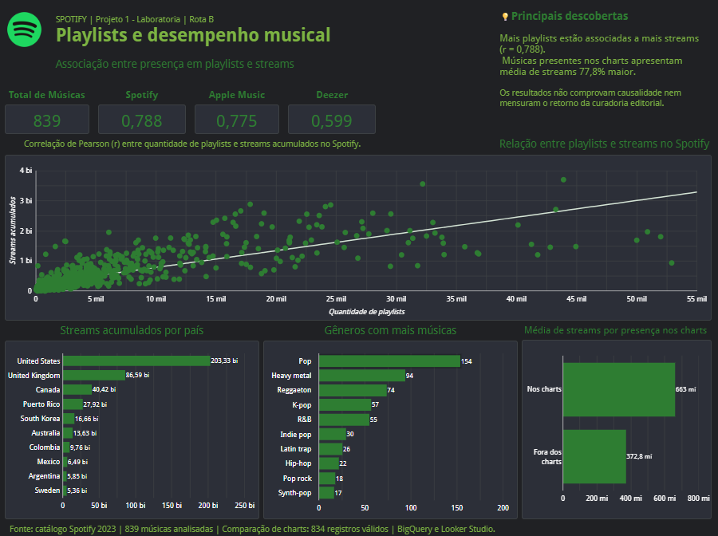

# Spotify | Playlists e desempenho musical 🎧

**Projeto de análise de dados desenvolvido durante a capacitação da Laboratoria.** Investigação da relação entre presença de músicas em playlists, rankings musicais (*charts*) e streams acumulados no Spotify, com foco em apoiar hipóteses e decisões de curadoria.

**[🌐 Conhecer o portfólio](https://janaina01.github.io/spotify-playlist-analysis/)** · **[📄 Ler a ficha técnica](https://janaina01.github.io/spotify-playlist-analysis/ficha-tecnica.html)** · **[📊 Explorar o dashboard interativo](https://datastudio.google.com/reporting/d1a84072-af82-44c5-b6d8-b8ee2670ac36)**

## Perguntas de negócio

1. Músicas presentes em mais playlists tendem a acumular mais streams?
2. Músicas presentes nos charts do Spotify apresentam desempenho diferente das que estão fora deles?

## Principais resultados

| Indicador | Resultado |
| --- | ---: |
| Músicas analisadas na base integrada | **839** |
| Correlação entre playlists do Spotify e streams do Spotify | **0,7882** |
| Correlação entre playlists da Apple Music e streams do Spotify | **0,7748** |
| Correlação entre playlists do Deezer e streams do Spotify | **0,5990** |
| Média de streams de músicas nos charts versus fora dos charts | **+77,8%** |

A correlação positiva entre playlists do Spotify e streams permaneceu forte (**r = 0,7759**) em uma análise de sensibilidade que excluiu valores de streams acima do percentil 99. Na comparação de charts, foram utilizados **834 registros válidos**: 473 músicas presentes nos charts (média aproximada de 663 milhões de streams) e 361 ausentes (média aproximada de 372,8 milhões).

> **Interpretação:** os resultados mostram associações entre playlists, rankings e streams acumulados. **Não demonstram causalidade nem permitem mensurar o retorno financeiro da curadoria editorial.** Nas análises entre plataformas, a variável de reproduções é sempre o total de streams **do Spotify**.

## Dashboard executivo



**[Abrir dashboard interativo no Data Studio](https://datastudio.google.com/reporting/d1a84072-af82-44c5-b6d8-b8ee2670ac36)**

## Ferramentas e etapas

**Ferramentas:** SQL, Google BigQuery, Data Studio, Jira, Confluence, Git e GitHub Pages.

1. **Preparação:** identificação de nulos, duplicatas e valores extremos; padronização de países, gêneros e identificadores.
2. **Integração:** relacionamento das tabelas de Spotify e concorrência por `track_id`, com `LEFT JOIN` e criação de view no BigQuery.
3. **Exploração:** distribuição de músicas e streams por país, gênero e ano de lançamento.
4. **Análise:** correlações de Pearson, análise de sensibilidade e comparação da média de streams entre músicas presentes e ausentes dos charts.
5. **Comunicação:** dashboard executivo, ficha técnica e site público do projeto.

## Estrutura do repositório

```text
spotify-playlist-analysis/
├── assets/
│   └── dashboard.png
├── docs/
│   ├── ficha_tecnica.md
│   └── origem_dos_scripts.md
├── sql/
│   ├── 01_preparacao_dados.sql
│   ├── 02_integracao_views.sql
│   ├── 03_analise_exploratoria.sql
│   ├── 04_correlacoes.sql
│   ├── 05_indicadores_dashboard.sql
│   └── 06_validacoes.sql
├── ficha-tecnica.html
├── index.html
└── README.md
```

**Documentação:** [ficha técnica em Markdown](docs/ficha_tecnica.md) · [origem e rastreabilidade dos scripts](docs/origem_dos_scripts.md).

**Consultas SQL:** [preparação](sql/01_preparacao_dados.sql) · [integração](sql/02_integracao_views.sql) · [exploração](sql/03_analise_exploratoria.sql) · [correlações](sql/04_correlacoes.sql) · [indicadores](sql/05_indicadores_dashboard.sql) · [validações](sql/06_validacoes.sql).

## Reprodutibilidade e origem das consultas

As consultas utilizam o projeto BigQuery `projeto-spotify-513019` e o dataset `dados_spotify`. Para executá-las em outro ambiente, é necessário ajustar os identificadores e disponibilizar as tabelas de origem conforme as permissões de uso dos dados.

Parte dos scripts foi **recuperada do histórico de jobs do BigQuery**, com comentários e agrupamento para apresentação; outras consultas foram **organizadas posteriormente** para facilitar exploração e validação. Os detalhes estão em [origem dos scripts](docs/origem_dos_scripts.md). **Os resultados e scripts ainda devem ser reexecutados no BigQuery para validação de ponta a ponta.**

> **Atenção:** comandos `CREATE OR REPLACE` podem substituir objetos existentes. Revise o projeto e o dataset de destino antes da execução.

## Limitações e próximos passos

A amostra não representa todo o catálogo do Spotify. A base não diferencia adequadamente playlists editoriais, algorítmicas e de usuários; não inclui custos de curadoria nem séries temporais comparáveis. Como evolução, seria importante acompanhar o desempenho antes e depois da inclusão em playlists e segmentar os resultados por tipo de playlist.

## Autoria

**Janaína Ramos de Oliveira** · Projeto individual desenvolvido durante a capacitação da **Laboratoria**.
